# Modelo de dados

Base: [ADR-0001](adr/0001-isolamento-multi-tenant.md). Nomes físicos em `snake_case`; ids `uuid` v7; datas `timestamptz` UTC; dinheiro `numeric(12,2)`.

## Dois bancos lógicos

| Banco | Conteúdo | RLS | Quem acessa |
|---|---|---|---|
| **`plataforma`** (catálogo) | tenants, domínios, identidade de usuários e vínculos, planos, assinaturas, cobrança da plataforma, catálogo de veículos (fonte) | Não — dados da plataforma | API (resolução de tenant, login), superadmin |
| **`lojas`** (dados de tenant) | tudo que pertence a uma loja | **Sim**, em toda tabela com `tenant_id` | API e Worker com `app_user` |

Um tenant grande pode ter seu próprio banco `lojas_<slug>` (RNF08): `tenant.database_key` aponta para a conexão. Por isso **não há chave estrangeira entre os bancos**; referências cruzadas são ids validados pela aplicação.

Tabelas de referência globais (veículos, categorias de referência) são **replicadas** do banco `plataforma` para o schema `ref` de cada banco `lojas` — hoje pela própria importação (`migrator importar-veiculos`, mesmos ids; `app_user` só tem SELECT em `ref`) — assim `part_compatibility` pode ter FK local para `ref.vehicle_version`.

## Banco `plataforma`

```mermaid
erDiagram
    TENANT ||--o{ TENANT_DOMAIN : "tem"
    TENANT ||--o{ TENANT_MEMBERSHIP : "tem"
    USER_ACCOUNT ||--o{ TENANT_MEMBERSHIP : "participa"
    PLAN ||--o{ PLAN_LIMIT : "define"
    PLAN ||--o{ PLAN_FEATURE : "habilita"
    TENANT ||--o{ SUBSCRIPTION : "assina"
    PLAN ||--o{ SUBSCRIPTION : ""
    SUBSCRIPTION ||--o{ PLATFORM_INVOICE : "gera"
    VEHICLE_BRAND ||--o{ VEHICLE_MODEL : ""
    VEHICLE_MODEL ||--o{ VEHICLE_VERSION : ""

    TENANT {
        uuid id PK
        string slug UK
        string cnpj UK
        string legal_name
        string trade_name
        string status "onboarding|active|read_only|suspended|closing|closed"
        string database_key "conexão do banco de dados do tenant"
        timestamptz custom_storefront_since "RF40: loja personalizada desde; nulo = Dono edita a aparência"
        timestamptz created_at
    }
    CHANNEL_ACCOUNT {
        uuid id PK
        uuid tenant_id FK "RF26: dono da conta no canal"
        string channel "UK (channel, external_account_id)"
        string external_account_id "ex.: user_id do vendedor no ML"
        timestamptz created_at
    }
    TENANT_DOMAIN {
        uuid id PK
        uuid tenant_id FK
        string host UK "www.loja.com.br"
        string kind "platform_subdomain|custom_www|custom_apex"
        string verification_status "pending|verified|failed"
        string verification_token "TXT _ecomm-verificacao (RF03)"
        timestamptz requested_at
        timestamptz last_checked_at
        string last_check_message
        timestamptz verified_at
        bool is_primary
    }
    USER_ACCOUNT {
        uuid id PK
        string email UK
        string password_hash
        bool must_change_password
    }
    TENANT_MEMBERSHIP {
        uuid tenant_id PK
        uuid user_id PK
        string role "owner|operator"
    }
    PLAN {
        uuid id PK
        string code UK "essencial|profissional|completo"
        numeric monthly_price
        numeric setup_fee
    }
    PLAN_LIMIT {
        string plan_code PK "FK plan.code"
        string key PK "active_parts|users|ai_listings_month — sem linha = sem limite"
        int value
    }
    PLAN_FEATURE {
        string plan_code PK "FK plan.code"
        string feature PK "channel:mercado-livre|channel:meta|channel:olx|custom_domain|ai:part_from_photos|ai:buyer_answers|ai:price_suggestion|ai:daily_summary"
    }
    SUBSCRIPTION {
        uuid id PK
        uuid tenant_id FK
        uuid plan_id FK
        string status "trialing|active|past_due|canceled"
        date current_period_end
        string external_id "id no gateway da plataforma"
    }
    PLATFORM_INVOICE {
        uuid id PK
        uuid subscription_id FK
        string kind "monthly|setup|ai_overage"
        numeric amount
        date due_date
        string status
    }
    VEHICLE_BRAND {
        uuid id PK
        string name
    }
    VEHICLE_MODEL {
        uuid id PK
        uuid brand_id FK
        string name
    }
    VEHICLE_VERSION {
        uuid id PK
        uuid model_id FK
        int year_from
        int year_to
        string engine "1.6 8V Flex"
        string ml_reference "id equivalente no ML, se houver"
    }
```



Notas:
- Identidade fica no catálogo porque o login acontece **antes** de sabermos o tenant; um e-mail pode participar de mais de um tenant.
- Superadmin (RF07 CA3, ADR-0007), fora do diagrama: `platform_admins` (conta separada das de loja; `totp_secret_cipher` cifrado com a chave-mestra do cofre e `totp_key_version`, `totp_last_step` contra reuso do código, `mfa_enabled_at`, bloqueio como em `user_account`), `platform_admin_recovery_codes` (só hash SHA-256, `used_at`), `platform_admin_sessions` (hash do token do cookie, validade absoluta de 8 h, `revoked_at`) e `platform_audit_log` (somente inclusão: a migração revoga `UPDATE`/`DELETE`/`TRUNCATE` do `app_user`; sem FK, guarda `admin_email`, `action`, `tenant_id`, `details` redigido, `ip`, `correlation_id`).
- Implementado no RF07 (E1): `user_account` com `failed_login_count`, `locked_until` e `must_change_password` (superadmin não é `user_account`: tem tabela própria — ADR-0007); `tenant.plan_code` → `plan.code` (plano vigente até existir `subscription`); `plan_limit` chaveado por `(plan_code, key)`; `refresh_token` (só o hash SHA-256, `family_id` para revogar a sessão inteira, `tenant_id` da loja escolhida, `used_at`/`revoked_at`). Tabelas com `tenant_id` neste banco não têm RLS: todo acesso filtra o tenant explicitamente e tem teste de isolamento.

## Banco `lojas` — todas as tabelas abaixo têm `tenant_id` + RLS

### Catálogo e estoque

```mermaid
erDiagram
    PART ||--o{ PART_PHOTO : ""
    PART ||--o{ PART_OEM_CODE : ""
    PART ||--o{ PART_COMPATIBILITY : ""
    DONOR_VEHICLE ||--o{ PART : "origem (peça usada)"
    PART ||--|| STOCK : ""
    PART ||--o{ STOCK_RESERVATION : ""
    PART ||--o{ STOCK_MOVEMENT : ""
    PART ||--o{ CHANNEL_LISTING : "anunciada em"
    CHANNEL_CONNECTION ||--o{ CHANNEL_LISTING : ""
    REF_VEHICLE_VERSION ||--o{ PART_COMPATIBILITY : ""

    PART {
        uuid id PK
        uuid tenant_id "RLS"
        string internal_code "UK (tenant_id, internal_code)"
        string title
        text description
        string condition "new|used|refurbished"
        numeric price
        int weight_g "embalagem; nulo = não informado"
        int length_cm
        int width_cm
        int height_cm
        string status "draft|active|inactive (sem exclusão)"
        string ncm "RF19: nulo = padrão da loja"
        string tax_code "CSOSN (Simples) ou CST do ICMS; nulo = padrão"
        int fiscal_origin "0 a 8; nulo = padrão"
        jsonb extra_attributes "atributos do ML etc."
        bool ai_generated_pending_review
        tsvector search_vector
        uuid donor_vehicle_id FK "RF10 — origem; só no painel"
        string traceability_tag "etiqueta de rastreabilidade; UK (tenant_id, tag) parcial"
        jsonb custom_fields "campos extras de rastreabilidade configurados na loja"
    }
    STOCK {
        uuid part_id PK
        uuid tenant_id "RLS"
        int on_hand "CHECK >= 0"
        int reserved "CHECK >= 0 AND reserved <= on_hand"
        int available "GENERATED on_hand - reserved"
        bigint version
    }
    STOCK_RESERVATION {
        uuid id PK
        uuid tenant_id "RLS"
        uuid part_id FK
        uuid order_id FK
        int quantity
        string status "active|converted|expired|released"
        timestamptz expires_at
    }
    STOCK_MOVEMENT {
        uuid id PK
        uuid tenant_id "RLS"
        uuid part_id FK
        int delta
        string reason "sale|counter_sale|cancel|return|adjust|import|reconcile"
        uuid order_id "nullable"
        uuid user_id "nullable"
        timestamptz at
    }
    PART_PHOTO {
        uuid id PK "também é a chave dos arquivos no storage"
        uuid tenant_id "RLS"
        uuid part_id FK
        int position "0 = capa; 0..19"
        string original_content_type
        timestamptz created_at
    }
    PART_OEM_CODE {
        uuid tenant_id "RLS"
        uuid part_id PK
        string code PK "só letras e dígitos, maiúsculo"
    }
    PART_COMPATIBILITY {
        uuid id PK
        uuid tenant_id "RLS"
        uuid part_id FK
        uuid vehicle_version_id FK
        string source "manual|ai_suggested|ml_import"
        bool confirmed
    }
    PART_IMPORT {
        uuid id PK
        uuid tenant_id "RLS — importação de peças por planilha (RF11)"
        uuid user_id "quem enviou; movimentos de estoque em nome dele"
        string file_name
        string status "validated|processing|completed"
        int total_rows "linhas de dados no arquivo"
        jsonb rows "linhas válidas já normalizadas, cadastradas em lotes"
        int error_count
        jsonb errors "linha + motivo (até 500 listados)"
        int existing_codes_at_preview "informativo"
        int processed_rows "progresso, gravado na transação de cada lote"
        int imported_count
        jsonb skipped "linha + código já cadastrado (pulado, Q33)"
        timestamptz created_at
        timestamptz started_at
        timestamptz finished_at
    }
    DONOR_VEHICLE {
        uuid id PK
        uuid tenant_id "RLS — veículo doador (RF10, Lei 12.977); só no painel"
        string plate "ABC1234 ou ABC1D23; UK (tenant_id, plate) parcial"
        string chassis "VIN 17; UK (tenant_id, chassis) parcial; CHECK placa ou chassi"
        string renavam "11 dígitos, DV conferido; UK parcial"
        string brand_model_year_color
        string deregistration_certificate "nº da certidão de baixa"
        string entry_invoice_key "chave da NF de entrada (44 dígitos, DV conferido)"
        date entry_date
        string notes
    }
    CHANNEL_CONNECTION {
        uuid id PK
        uuid tenant_id "RLS"
        string channel "mercado-livre|meta|olx|canal-simulado (dev)"
        string external_account_id "UK (tenant_id, channel, external_account_id); espelhado em plataforma.channel_accounts"
        string status "active|reauth_required|disabled"
        uuid secret_id FK "tokens no cofre (RF21)"
    }
    CHANNEL_LISTING {
        uuid id PK
        uuid tenant_id "RLS"
        uuid part_id FK "UK (tenant_id, part_id, connection_id)"
        uuid connection_id FK
        string external_id "MLB123...; UK (tenant_id, connection_id, external_id)"
        string status "pending|active|paused_by_system|paused_by_user|closed|error"
        int last_pushed_quantity
        numeric last_pushed_price
        timestamptz last_synced_at
        string last_error "última falha (limpa ao sincronizar)"
        timestamptz last_reconciled_at "RF27: última conferência com o canal"
    }
    REF_VEHICLE_VERSION {
        uuid id PK "réplica de plataforma.vehicle_version"
    }
```



**Regra de estoque (RNF02):** reserva e baixa são um único `UPDATE` condicional:
```sql
UPDATE stock SET reserved = reserved + @qty, version = version + 1
WHERE part_id = @part AND on_hand - reserved >= @qty;   -- 0 linhas = sem saldo
```
As `CHECK` constraints são a última barreira contra saldo negativo.

### Pedidos, pagamento e fiscal

```mermaid
erDiagram
    CUSTOMER ||--o{ CUSTOMER_ORDER : ""
    CUSTOMER_ORDER ||--|{ ORDER_ITEM : ""
    CUSTOMER_ORDER ||--o{ PAYMENT : ""
    CUSTOMER_ORDER ||--o{ SHIPMENT : ""
    CUSTOMER_ORDER ||--o{ FISCAL_DOCUMENT : ""
    CUSTOMER_ORDER ||--o{ STOCK_RESERVATION : ""
    CUSTOMER_ORDER ||--o{ ORDER_HISTORY : ""
    CUSTOMER_ORDER ||--o{ ORDER_RETURN : "devoluções (RF20)"

    CUSTOMER {
        uuid id PK
        uuid tenant_id "RLS"
        string email "UK (tenant_id, email)"
        string name
        string document "CPF/CNPJ — só quando exigido pela NF-e"
        string phone
        jsonb addresses
        timestamptz anonymized_at "LGPD"
    }
    CUSTOMER_ACCESS_LINK {
        uuid id PK
        uuid tenant_id "RLS"
        string email "RF16: e-mail do comprador (minúsculo)"
        bytea token_hash "UK (tenant_id, hash) — SHA-256; o token só vai no e-mail"
        timestamptz expires_at "15 min"
        timestamptz used_at "uso único (UPDATE condicional)"
    }
    CUSTOMER_SESSION {
        uuid id PK
        uuid tenant_id "RLS"
        string email "vê os pedidos do site com este e-mail"
        bytea token_hash "UK (tenant_id, hash) — cookie HttpOnly"
        timestamptz expires_at "30 dias"
        timestamptz ended_at "Sair"
    }
    CUSTOMER_ORDER {
        uuid id PK
        uuid tenant_id "RLS"
        bigint number "UK (tenant_id, number) — sequencial por tenant (order_counters)"
        string origin "site|mercado_livre|olx|counter"
        string external_id "UK (tenant_id, origin, external_id) — canais (E2)"
        uuid customer_id FK "conta de cliente (RF16); convidado não tem"
        bytea access_token_hash "UK (tenant_id, hash) — link do comprador e idempotência do checkout e do balcão"
        string buyer_name_email_phone_cpf "cópia no pedido (convidado); no balcão, opcionais (vazios) e nome Consumidor final"
        string buyer_cnpj "cliente PJ no balcão (RF18); CNPJ pode ser alfanumérico"
        string payment_method "só balcão: cash|pix|debit_card|credit_card|other — CHECK (origin = counter) = (payment_method IS NOT NULL)"
        string delivery_method "shipping|pickup"
        string delivery_address "colunas delivery_* — só na entrega"
        string shipping_service "id, transportadora, serviço, prazo cotados"
        string pickup_address "cópia do endereço de retirada"
        string status "pending_payment|paid|needs_review|shipped|delivered|picked_up|returned|canceled (invoiced: RF19)"
        numeric items_total
        numeric shipping_total
        numeric total "CHECK = items_total + shipping_total"
        timestamptz placed_at
        timestamptz payment_deadline "fim da reserva; sem pagamento, cancela"
        timestamptz paid_at
        string review_reason "por que está em análise (needs_review)"
        string tracking_code "rastreio informado ao marcar enviado (RF17)"
        timestamptz shipped_at
        timestamptz delivered_at "entregue ou retirado"
        timestamptz canceled_at
        string canceled_by "payment_expired|store — pagamento atrasado só reativa o cancelado pelo prazo"
        string cancel_reason "motivo (obrigatório quando a loja cancela)"
        bool has_returns "teve devolução: não cancela mais"
        timestamptz returned_at "tudo devolvido (status returned)"
    }
    INTEGRATION_LOG {
        uuid id PK
        uuid tenant_id "RLS — chamada externa (RF29); retenção 90 dias"
        timestamptz at
        string channel "mercado-pago|cielo|melhor-envio|fake (canais na E2)"
        string operation "criar cobrança|validar aviso de pagamento|consultar pagamento|cotar frete"
        bool success
        int duration_ms
        string error_summary "redigido: sem tokens, CPF, e-mail"
        string reference "id no serviço externo"
        uuid order_id "ligado depois pela correlação, se preciso"
        uuid part_id
        string correlation_id
    }
    MESSAGE_FAILURE {
        uuid id PK
        uuid tenant_id "RLS — processamento em segundo plano que esgotou as tentativas (RF28)"
        uuid envelope_id "id na wolverine_dead_letters (reprocessar)"
        string message_type
        string description "ex.: Confirmar pagamento no gateway"
        int attempts
        string error_type
        string error_summary "redigido"
        string status "pending|replayed"
        timestamptz failed_at
        timestamptz replayed_at
        uuid replayed_by
    }    ORDER_RETURN {
        uuid id PK
        uuid tenant_id "RLS — devolução (RF20)"
        uuid order_id FK
        jsonb lines "peça, código, título, quantidade, volta ao estoque? (avariada = não)"
        string reason "regret|defect|wrong_part|other"
        string note
        numeric refund_amount "informativo: o estorno é feito fora"
        string refund_method "gateway|pix|cash|store_credit|other"
        uuid user_id
        timestamptz at
    }    ORDER_HISTORY {
        uuid id PK
        uuid tenant_id "RLS"
        uuid order_id FK
        string from_status "nulo na criação"
        string to_status
        string actor "buyer|user|payment|system"
        uuid user_id "quem fez, quando actor = user"
        string note "motivo, rastreio, razão da análise"
        timestamptz at
    }
    ORDER_ITEM {
        uuid id PK
        uuid tenant_id "RLS"
        uuid order_id FK
        uuid part_id FK
        uuid reservation_id FK "UK — reserva que segura a peça"
        int quantity
        numeric unit_price "preço do momento da compra"
        string title "cópia do título"
        string internal_code "cópia do código"
    }
    ORDER_COUNTER {
        uuid tenant_id PK "RLS"
        bigint last_number "UPSERT na transação do pedido"
    }
    PAYMENT {
        uuid id PK
        uuid tenant_id "RLS"
        uuid order_id FK
        string gateway "fake|mercado-pago|cielo"
        string external_id "UK (tenant_id, gateway, external_id)"
        string method "como o gateway informa (pix, cartão…)"
        string status "pending|approved|rejected|refunded|canceled — sempre consultado no gateway"
        numeric amount
        timestamptz updated_at
    }
    SHIPMENT {
        uuid id PK
        uuid tenant_id "RLS"
        uuid order_id FK
        string provider "melhor_envio|mercado_envios|pickup"
        string tracking_code
        string status
    }
    FISCAL_DOCUMENT {
        uuid id PK
        uuid tenant_id "RLS"
        uuid order_id FK "UK parcial (tenant_id, order_id) com status processing|authorized — uma nota ativa por pedido"
        string source "provider|external (chave/XML informados)"
        string status "processing|authorized|rejected|canceled — cada tentativa é uma linha"
        string reference "UK (tenant_id, reference) — PED{número}-{tentativa}, id da nota no provedor"
        string provider "ex.: focus-nfe"
        string environment "homologation|production"
        jsonb recipient "destinatário enviado (nome, CPF/CNPJ, e-mail, endereço)"
        string access_key "44 posições; CNPJ pode ser alfanumérico"
        int number_series "número e série"
        string message "motivo da rejeição"
        string xml_storage_key "bucket privado {tenant}/nfe/{id}.xml"
        string danfe_storage_key "{tenant}/nfe/{id}.pdf"
        timestamptz authorized_at "cancelamento até +24 h"
        string cancel_justification "15 a 255 caracteres"
    }
```



### Integração, IA, segurança e operação

```mermaid
erDiagram
    INBOX_EXTERNAL_EVENT {
        uuid id PK "schema inbox, SEM RLS (ADR-0001) — aviso antes de saber a loja"
        string source "canal (ex.: mercado-livre)"
        string idempotency_key "UK (source, idempotency_key)"
        string external_account "conta do vendedor no canal"
        string topic
        string resource "recurso a consultar no canal"
        string payload "corpo do aviso, até 16 KB (diagnóstico)"
        string status "pending|routed|unroutable"
        uuid tenant_id "nulo até o roteamento"
        timestamptz received_at "roteados saem com 30 dias; sem dono, 90"
    }
    EXTERNAL_EVENT {
        uuid id PK
        uuid tenant_id "RLS — da URL do webhook (pagamentos) ou do roteamento do inbox (canais)"
        string source "mercado_livre|mercado_pago|cielo|meta|olx_hub|fiscal"
        string idempotency_key "UK (tenant_id, source, idempotency_key)"
        string resource_id "recurso a consultar na origem"
        jsonb payload
        string status "received|processed|ignored|failed"
        timestamptz received_at
    }
    INTEGRATION_LOG {
        uuid id PK
        uuid tenant_id "RLS"
        string channel
        string operation "publish|update|pause|resume|reconcile|webhook"
        uuid part_id "nullable"
        uuid order_id "nullable"
        string status "ok|error|retrying"
        int duration_ms
        string error_summary "sem segredos"
        string correlation_id
        timestamptz at
    }
    TENANT_SECRET {
        uuid id PK
        uuid tenant_id "RLS"
        string kind "gateway_key|a1_certificate|oauth_token|..."
        bytea ciphertext
        bytea wrapped_data_key
        string key_version
        string hint "últimos 4 caracteres"
        timestamptz expires_at
    }
    BUYER_QUESTION {
        uuid id PK
        uuid tenant_id "RLS"
        string channel
        string external_id
        uuid part_id
        text question
        text answer
        string status "pending|draft_ready|answered_auto|answered_human"
    }
    AI_INTERACTION {
        uuid id PK
        uuid tenant_id "RLS"
        uuid user_id "nullable"
        string feature "part_from_photos|buyer_answer|daily_summary|sync_diagnosis|price_suggestion"
        string model
        int input_tokens
        int output_tokens
        numeric estimated_cost
        jsonb input_summary
        jsonb output
        timestamptz at
    }
    AI_USAGE_COUNTER {
        uuid tenant_id PK
        string feature PK
        date period PK "primeiro dia do mês"
        int used
    }
    STORE_BRANDING {
        uuid tenant_id PK
        string primary_color "#RRGGBB"
        string background_color
        string text_color
        string about "texto institucional"
        string return_policy "trocas e devoluções"
        string footer
        timestamptz updated_at
    }
    STORE_SETTINGS {
        uuid tenant_id PK
        int reservation_minutes "padrão 30"
        jsonb shipping "CEP origem, retirada"
        jsonb payment "gateway escolhido"
        bool dismantler_mode "RF10: modo desmontadora (Lei 12.977)"
        jsonb traceability_fields "campos extras: chave, rótulo, obrigatório"
        string contact_email "Q38: resposta dos e-mails do remetente da plataforma"
        jsonb fiscal "RF19: modo, ambiente, regime, UF e padrões (NCM, CFOP, CSOSN/CST, origem); nulo = emissão desligada"
        jsonb smtp "Q38: SMTP da loja (servidor, porta, segurança, usuário, remetente); senha no cofre (smtp:password); nulo = remetente da plataforma"
    }
    PERSONAL_DATA_ACCESS_LOG {
        uuid id PK
        uuid tenant_id "RLS; somente inclusão (REVOKE UPDATE/DELETE do app_user)"
        uuid user_id
        string user_email
        string action "pedido.aberto|nfe.baixada|titular.anonimizado|exportacao.gerada|exportacao.baixada"
        uuid order_id "sem FK"
        string details "redigido, nunca o dado pessoal"
        string ip
        timestamptz at
    }
    DATA_EXPORT {
        uuid id PK
        uuid tenant_id "RLS; único parcial: uma Pending por loja"
        string status "Pending|Ready|Failed|Expired"
        uuid requested_by
        string requested_by_email
        string storage_key "privado: {tenant}/exportacoes/{id}.zip"
        bigint size_bytes
        timestamptz expires_at "RF39: concluída + 7 dias"
        string error
    }
```



**Nota sobre `EXTERNAL_EVENT` e o inbox (RF26, implementado em 13/10/2026):** o aviso de canal chega antes de sabermos a loja (ex.: o ML identifica o vendedor por `user_id`). O webhook responde 2xx e grava em `inbox.external_events` (sem RLS; `UNIQUE (source, idempotency_key)`); o roteamento procura a loja em **`plataforma.channel_accounts`** (canal + conta externa → loja; a consulta por loja em `channel_connection` não serve, pois ela tem RLS e exige a loja definida) e publica o evento já no escopo da loja, onde ele entra em `external_events` (RLS, chave única por loja) antes do processador do canal — reentrega em qualquer ponto não repete o efeito. Conta sem loja fica `unroutable` e gera log crítico.

**LGPD (RNF04, implementado em 15/10/2026):** `store_brandings` ganhou `privacy_policy` e `terms` (vazio = modelo padrão); `customer_orders` ganhou `anonymized_at` e a regra de entrega aceita pedido anonimizado sem CEP.

## Onde está o `tenant_id` — resumo

| Local | `tenant_id` | RLS |
|---|---|---|
| `plataforma.*` | Coluna em `tenant_domain`, `tenant_membership`, `subscription` | Não (acesso só pela API/superadmin) |
| `lojas.public.*` (negócio) | **Obrigatório, NOT NULL**, primeiro campo de todo índice | **Sim**, `FORCE` |
| `lojas.ref.*` (veículos, categorias) | Não tem | Não; somente leitura para `app_user` |
| `lojas.inbox.*` (avisos de canal antes do roteamento) | Nulo até rotear | Não (ADR-0001); `app_user` com SELECT/INSERT/UPDATE/DELETE só em `inbox.external_events`, sem criar objetos |
| `lojas.wolverine.*` (fila/outbox) | Dentro da mensagem | Não |
